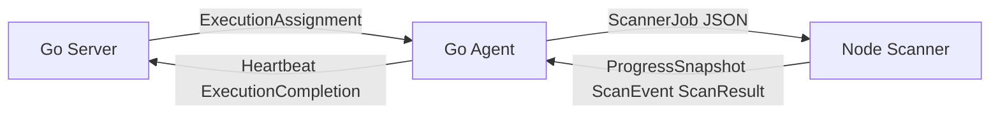

# Server Agent Scanner 合同解耦方案

> 历史设计记录：以下现状与风险对应步骤 1 开始前。步骤 1–9 的合同、权限、预算和存储实现已完成，当前能力及限制以 [成熟化基线](MATURITY_BASELINE.md) 为准。
保留 Go Server、Go Agent、Node Scanner。以独立的 JSON Schema 定义进程和 HTTP 边界的数据，生成 Go 与 TypeScript 类型，并在边界做运行时校验。Server 管业务与租约，Agent 管执行和传输，Scanner 管 SDK 适配；数据库行、启动命令和 SDK 原生结构分别留在各自实现中。

产品交互要求为纯 Web：使用者通过浏览器上传源码、配置模型、创建/取消/重试扫描、查看进度与报告。Go Agent、Node Scanner 和 SDK 在服务端运行，文中的 CLI、argv、`--describe` 和 `--job` 均指由后台自动处理的进程接口。新增业务能力必须提供网页及对应 API；不能让使用者手动执行 Scanner 命令作为功能入口。

当前优先修复预算参数缺口、结果字段裁剪、执行标识缺失和进度合并分散。采用分步兼容迁移，保留当前 PostgreSQL 调度、独立扫描进程、原始证据归档与每次执行的目录隔离。

检查基线为 2026 年 10 月 13 日的当前工作区，包含已有未提交修改。下面的目标合同和实施步骤是提案。

当前输入经过如下转换：

| 边界 | 当前数据 | 当前负责转换的位置 |
| --- | --- | --- |
| Web 到 Server | 创建扫描请求，路径与重点为数组 | [创建扫描](../code-audit-server/internal/httpserver/server.go:200) |
| Server 到数据库 | `store.Task`，数组变为 JSON 字符串 | [任务行](../code-audit-server/internal/store/store.go:24) |
| Server 到 Agent | `Lease.Task` 直接使用 `store.Task`，另带租约与临时凭据 | [领取协议](../code-audit-agent/pkg/execution/protocol.go:8) |
| Agent 到 Scanner | `scanner.Request` 变为多个 argv，验证选项与业务背景走环境变量 | [启动适配](../code-audit-agent/internal/scanner/scanner.go:104) |
| Scanner 内部 | CLI 再拼装 TypeScript `ScanTask`，调用 SDK | [入口](../code-audit-scanner/src/main.ts:22) |
| Scanner 到 Agent 到 Server | 进度文件、结果文件，经心跳和完成请求回传；日志另由 Server 读共享目录 | [执行回传](../code-audit-agent/internal/worker/worker.go:82) |

**已经确认的合同问题**

这里的 P1 表示优先处理的正确性与信息保留问题，P2 表示随后处理的结构与版本治理问题。

| 优先级 | 问题与证据 | 实际影响 |
| --- | --- | --- |
| P1 | `maxCostUsd` 存在于 [Scanner 输入](../code-audit-scanner/src/contract/scan-task.ts:56) 和 CLI，但 Server 创建请求、任务行、Agent Request 都没有对应字段 | Web 任务链路无法下发该预算。公共 API 的普通 Decode 还会忽略未知字段，客户端仅添加参数并不能使预算生效 |
| P1 | Agent 把 `includePaths` 用逗号连接，Scanner [用逗号拆分](../code-audit-scanner/src/main.ts:59) | 合法路径 `src/a,b.ts` 会变成 `src/a` 和 `b.ts`；数据库字符串和 CLI 字符串增加重复编解码 |
| P1 | [Go Result](../code-audit-agent/internal/scanner/scanner.go:56) 只保留 taskId、status、findings、error、coverage；Worker 再组装数据库 Finding 与 Completion | `cost`、`engine`、`model`、Scanner 时间和产物引用不进入当前完成归档。部分规范化 finding 字段也被裁剪；原始文件、finding.raw 和 coverage 仍可保留，不能称为全部证据丢失 |
| P1 | Scanner 输入、进度和结果只有 taskId，没有 execution attempt 和合同版本。[结果读取](../code-audit-agent/internal/scanner/scanner.go:184) 只做 JSON 解码，Worker 不校验结果 taskId 是否与任务一致 | 数据库的租约归属校验已存在，但没有建立 Scanner 产物与当前执行之间的身份校验 |
| P1 | [错误名称](../code-audit-scanner/src/contract/scan-result.ts:55) 有 `auth_failed`、`rate_limited`；[Go 分类](../code-audit-server/internal/store/failure.go:17) 使用另一组名称并再次解析 message。[HTTP 客户端](../code-audit-agent/pkg/execution/client.go:43) 将所有 409 都视为租约丢失 | 同一错误可能因消息措辞不同而得到不同代码；配置冲突、结果冲突、租约丢失无法准确区分 |
| P1 | [标准进度](../code-audit-scanner/src/contract/progress.ts:22) 与 [SDK 投影](../code-audit-scanner/src/runtime/sdk-progress-observer.ts:15) 是两套文件；[Server 合并](../code-audit-server/internal/httpserver/live_progress.go:12) 决定哪些字段覆盖心跳 | TS 标准合同不包含 phaseProgress、progressSource 等投影字段；最新事实和缺失值语义由多个组件维护 |
| P2 | [事件合同](../code-audit-scanner/src/contract/progress.ts:49) 只有 timestamp、level、kind、message；线程和计数被拼进文本。[前端](../code-audit-web/src/utils/scan-log.ts:5) 用正则恢复状态与分类 | 修改文本格式或语言就可能影响行为；文件行号承担游标职责，事件本身缺少执行标识、序号和结构化 payload |
| P2 | Server 创建任务时保存 provider、model、baseUrl，[领取时](../code-audit-server/internal/httpserver/execution.go:56) 再读取当前配置的 wireApi 和凭据 | 排队期间修改配置，可能产生两个配置时点拼接的执行输入；凭据轮换与参数修改没有显式区分 |
| P2 | Server、Agent、Scanner 各自设默认值和验证。Scanner validator 接受未知 scanMode、非整数 workers、负 maxCostUsd；Server 对重复路径和部分路径规范化的处理也不同 | 有些错误延后到 SDK 才暴露；API 接受与 Scanner 接受并不等价。SDK 可能进一步拒绝这些值，不能据此认定真实扫描会成功执行 |
| P2 | Server 与执行客户端直接依赖 Agent 的 store 包；Go provider 注册表与 TS provider 类型、内置配置和凭据检查同时存在 | 数据库字段变动影响进程协议；增加 provider 仍受 Scanner 内置注册表约束，尚未达到只改 Go 注册表的目标 |

另外，Scanner 错误码注释列出认证等分类退出码，但实际 `SCAN_EXIT_CODES` 按终态映射，例如所有 failed 都是 2。Agent 在结果文件可读取时忽略进程退出错误。新版需要明确结果提交与退出码的关系，而不是把所有非零退出码都当成失败或全部忽略。

**目标合同与职责**

建议建立 `../contracts/`，作为 Axiom 边界数据的唯一可编辑定义源。采用 [JSON Schema Draft 2020-12](https://json-schema.org/draft/2020-12)，共同约束字段、枚举、必填项、空值与范围。生成的类型仍需运行时校验；JSON Schema 不替代租约、权限、文件存在性和路径归属等业务检查。

| 合同 | 生产者与消费者 | 内容与边界 |
| --- | --- | --- |
| `ExecutionAssignment` | Server 到 Agent | 执行标识、源码快照引用、已解析模型配置、扫描策略；租约与临时凭据使用独立部分，不暴露数据库 Task 行 |
| `ScannerJob` | Agent 到 Scanner | 当前机器物化后的 sourcePath、outputPath，执行标识、模型描述和策略；不包含用户资料、数据库字段、密钥值或租约控制 |
| `ProgressSnapshot` | Scanner 到 Agent 到 Server | 当前阶段、结构化计数、活动、费用估算、观测来源与时间；单一合同和单一合并责任 |
| `ScanEvent` | Scanner 到日志存储和展示 | 事件类型、序号、执行标识、结构化 data、可读 message、工作线程或工具标识 |
| `ScanResult` | Scanner 到 Agent 到 Server | 完整规范化结果、engine/model、费用、覆盖、证据、Scanner 时间、原生产物引用；保留明确的扩展区 |
| `ExecutionCompletion` | Agent 到 Server | 租约归属、执行终态、经过校验的结果或明确的执行错误、进程退出信息；调度结果与 Scanner 结论分别表达 |

Assignment 与 ScannerJob 共用 ExecutionRef、ResolvedModel 和 ScanPolicy；源码引用由 Agent 物化为本机路径。这样可以共享语义，同时避免把 Server 的数据库类型或宿主机路径规则强加给 Scanner。



建议的目录职责如下，具体文件均为后续实施目标：

```text
../contracts/
  schemas/v1/          ExecutionRef、Assignment、Job、Progress、Event、Result、Completion
  fixtures/v1/         共同的有效和无效合同样本
  data/                通用枚举、退出码、传输大小限制
  go/                  生成的 Go 类型与校验入口，独立 Go module
  ts/                  生成的 TS 类型与校验入口
  tools/               固定版本的生成与一致性检查脚本
```

合同包不引入数据库、SDK、Web 组件或进程启动逻辑。生产程序使用已生成并提交的代码，正常启动不需要执行生成器。工具选择须通过 nullable、union、额外字段、格式和往返样本验收，不能只根据能生成类型就确定；工具和生成配置一起固定版本。

新版 Server 与 Agent 控制接口建议使用 `/api/internal/v2/executions`，旧 `/api/internal/executions` 保留为兼容入口，公共 `/api/v1` 通过 DTO 映射保持既有格式。新版 presence/claim 申报支持的合同版本与能力，Server 只向满足任务策略的 Agent 派发任务。例如携带预算的新任务不能派给会忽略预算的旧 Agent；没有兼容执行机时保持排队并说明原因。HTTP 接口版本与消息 schemaVersion 分别管理。

输入合同重点做下面的调整：

| 项目 | 建议规则 |
| --- | --- |
| 执行身份 | 输入、事件、进度、结果都带 `{taskId, attempt}`。内部新合同 taskId 用十进制字符串，避免 Go int64 与 JS number 精度差异；现有公共 API 数值 ID 由兼容映射保留 |
| 合同版本 | 每种边界消息都带 `schemaVersion`。Scanner 另提供无模型调用的 `--describe`，声明支持的输入、事件、结果版本和能力；Agent 执行前核对 |
| 输入传输 | Agent 原子写入权限为 0600 的 `job.json`，启动只传 `--job <path>`。数组保持 JSON 数组；业务背景保持 JSON 字符串。密钥值继续只注入子进程环境，不写 job、事件、结果或常规日志 |
| 参数默认值 | Server 在创建任务时一次性归一化并保存有效策略；Agent 原样传递，Scanner 验证后映射为 SDK 参数。SDK 的 worker 默认值通过省略字段保留 |
| 超时 | ScanPolicy 显式提供扫描预算秒数与收尾宽限秒数。当前 deep 的 10 分钟收尾宽限由 Server 策略解析，不再分别硬编码到 Go 和 TS；外层超时与 SDK 原生期限从同一策略计算 |
| 校验 | 模式必须是已知枚举；计数为整数；maxCostUsd 为有限正数；deep 限制只适用于 deep。路径字符校验在规范化前后分别做，不能先去掉绝对路径标记再判断 |
| 源码 | Assignment 传快照 ID 与内容哈希，Agent 负责物化与核对；ScannerJob 带本机目录和快照身份。现有 sourcePath 创建方式显式标为 legacy host-local 输入，不能冒充已核验快照 |
| 模型配置 | 参数使用任务创建时的完整配置快照及 revision。凭据绑定有独立版本或明确的轮换策略，禁止旧 model/baseUrl 与新 wireApi 隐式拼接 |
| Provider | Axiom 配置层提供完整的 providerId、连接类型、wireApi、baseUrl、model、credentialEnv。Scanner 根据连接类型适配，品牌预设不再决定能否执行；模型兼容性仍需独立验收 |

以下是合同样例，使用合成路径和模型名，不表示真实任务或模型配置：

```json
{
  "schemaVersion": 1,
  "execution": { "taskId": "42", "attempt": 2 },
  "source": { "path": "/fixture/source", "snapshotId": "7", "contentHash": "0000000000000000000000000000000000000000000000000000000000000000" },
  "output": { "path": "/fixture/output/attempt-2" },
  "model": {
    "providerId": "openai",
    "connectionType": "openai",
    "model": "fixture-model",
    "wireApi": "responses",
    "credentialEnv": "OPENAI_API_KEY",
    "configurationRevision": "fixture-revision"
  },
  "policy": {
    "mode": "standard",
    "timeBudget": { "scanSeconds": 1800, "finalizationGraceSeconds": 0 },
    "includePaths": ["src/a,b.ts"],
    "focus": ["authz"],
    "maxCostUsd": 5,
    "validation": { "mode": "default" }
  }
}
```

maxCostUsd 是引擎估算预算，不应描述为绝对金额硬上限。输入接受某字段必须意味着该能力已接通；不支持的参数应明确拒绝，不能静默忽略。不同提供商的估算可用性与预算效果应通过能力说明表达。

进度与事件建议由 Scanner 的一个投影组件生成。SDK 回调和当前 SDK 工作台观察器都先进入该组件，选择来源和新鲜度后写一份 `state/progress.json`。SDK 工作台读取保持在 Scanner 内部；Agent 与 Server 都消费同一个 ProgressSnapshot，Server 不再读 sdk-progress.json 合并。

计数携带 unit 和来源，文件数、阶段工作项、deep 独立发现次数分别表示。未知计数为 null，0 表示已观测的零值；缺少完成数量不得转换为 0% 或完整覆盖。未知 SDK 阶段保存 rawPhase 并标为 unknown，不能自动归为 discovery。快照带 revision，Server 拒绝旧执行或旧 revision 覆盖新的快照；进度不可更改最终结论。

事件 data 提供事实，message 用于可读展示。下面的样例可直接表示阶段变化：

```json
{
  "schemaVersion": 1,
  "execution": { "taskId": "42", "attempt": 2 },
  "sequence": 18,
  "occurredAt": "2026-10-13T00:00:00Z",
  "type": "scan.phase_changed",
  "level": "info",
  "data": { "phase": "validation", "source": "engine_callback" },
  "message": "进入发现验证阶段"
}
```

另定义 activity、worker、cost、reconnect、warning 与终态相关事件。线程 ID、工具名、调用状态、计数和错误代码各有结构化字段。事件在单次执行内由单一写入者递增编号，使用 `(taskId, attempt, sequence)` 去重；timestamp 只用于时间展示。旧事件仍可通过 legacy 适配器展示文本，但不得从文本推断任务终态。

保留当前 JSONL 的追加写入、完整换行读取、增量游标和大小保护。先沿用共享卷存储，由统一事件读取适配器提供 API，现有 `n/after` 可兼容映射到 sequence；未来远程 Agent 使用相同事件合同批量上传。SSE、消息队列和多机产物传输均不作为本轮合同落地的前置条件。

结果合同需要完整穿过 Agent。Go 类型保留公共字段和合法的扩展 JSON，Worker 不再逐字段把 Scanner Finding 复制成数据库 Finding 后当作完整结果。Server 先保存完整结果和版本，再按索引需要提取 title、severity、位置、fingerprint 等列；人工确认、误报、修复状态留在业务记录，不进入引擎事实合同。

规范化 finding 应保留结构化代码证据、confidence 原始级别与 rationale、攻击路径、验证记录和原生 finding 标识。Go 往返必须保持这些字段。原始 finding、覆盖报告中的 SDK 字段继续放在明确的 raw 或 extensions 区域，消费者不据此自动改变执行状态。

ScanResult 同时记录引擎版本、插件版本、配置 revision、费用估算与 token、Scanner 开始结束时间和产物引用。执行机时间、排队时间与 Scanner 时间保持不同字段。产物以 kind、相对路径、大小和哈希描述；本机路径解析留在存储适配器，不能让 Server 再依赖 raw/codex-security 的具体内部布局。

历史结果缺失的元数据保持 unknown，不能用当前 SDK 版本或模型配置补成历史事实。若能从旧产物核对并补取，记录其来源和读取格式版本。

结果发布先写临时文件、完成写入并原子 rename，再发布一个带执行身份、字节大小和 SHA-256 的提交标记。Agent 读取提交结果后校验合同版本、身份、状态、数组类型、文件大小和哈希；提交标记用于完整性检查，不是安全证明或恢复 checkpoint。

| Agent 看到的情况 | 处理规则 |
| --- | --- |
| 合同、身份、提交标记均有效，退出码与结果终态一致 | 提交结果。partial 对应退出码 2，可正常保存 |
| 已提交有效结果，但进程异常退出 | 保留已提交结果并记录进程退出异常；采用明确的完成策略，不静默忽略异常 |
| 结果缺失、截断、身份不匹配或版本不兼容 | 不将其归为成功零漏洞；提交 Agent 层 invalid_result 或明确的协议错误，保留诊断产物 |
| 用户取消或硬超时 | 执行终态由 Agent 给出 canceled 或 timeout；若存在有效部分结果，单独保留，不混同为完整审计结论 |
| Agent 已丢失租约 | 停止执行，由现有 Server 归属校验拒绝提交；任何结果文件都不能取得新租约的归属 |

ExecutionCompletion 保留 executionStatus 和可选的完整 ScanResult；两者均由规则约束。Server 的公共扫描状态使用显式映射维持现有行为。完成请求幂等仍以执行身份和规范化内容摘要判断，同内容重送成功，不同内容返回 completion_conflict；不把它与 lease_expired 合并。

错误合同采用 `code、origin、message、retryable`，必要时带 retryAfterSeconds 和原生诊断引用。已知代码直接映射，Scanner 内的 SDK 适配器负责解释原生错误，Agent 只增加进程与租约错误，Server 不再次用文本猜测已知代码。retryable 表示重试资格，实际自动重试仍由调度策略决定。

旧代码的 `auth_failed` 映射到 authentication_error，rate_limited 映射到 rate_limit，result_corrupt 映射到 invalid_result；泛化的 provider_error 保留为 provider_error，不能一律当作网络不可用。SDK 估算预算耗尽与供应商额度耗尽分别用 budget_exceeded 和 quota_exhausted。HTTP 错误按结构化 code 区分配置问题、协议不兼容、结果冲突和租约丢失。

版本策略采用显式协商。输入和核心结果禁止未知属性，只在 extensions、raw 等指定区域允许扩展。由于严格接收者会拒绝新增核心字段，新增 optional 字段也不能默认视为兼容。合同结构变化发布新的 schemaVersion，消费者先支持新旧版本，再切换生产者；不支持时在模型启动前返回明确错误。JSON Schema 的额外属性规则见 [官方说明](https://json-schema.org/understanding-json-schema/reference/object#additionalproperties)。

**分步实施与验收**

每步独立形成可回退变更，按下表顺序实施。每个边界先增加消费者及兼容读取器，再按任务固定的版本切换生产者；未具备完整消费者的格式保持关闭。现有公共 Web API、当前任务和历史产物通过边界适配器逐步迁移。

| 步骤 | 具体改动 | 完成标准 |
| --- | --- | --- |
| 1 合同基线 | 新建 schemas、生成类型、版本说明和共同 fixtures；定义未知值、空值、默认值、错误别名、退出码及字节限制。加入无模型调用的 Scanner 描述能力 | Go 与 TS 对同一有效和无效样本给出一致结果；生成器重跑无差异；尚未切换线上传输 |
| 2 输入链路 | 增加 Assignment 与 ScannerJob 映射和能力派发校验；Scanner 支持 `--job`，Agent 从逐参数 argv 切为 JSON。显式保存策略与模型快照；通过增量迁移接通 nullable maxCostUsd，不自行给旧任务补预算 | 逗号路径、中文、多行背景、Windows 路径和省略值均正确往返；Web 创建参数到模拟引擎入口的预算值一致；预算任务不会派给旧 Agent；错误在执行前明确返回 |
| 3 结果链路 | 新版本 Completion 接收完整 ScanResult；原子发布、执行身份与大小校验、错误码归一、完整结果归档。将数据库 Finding 的复制映射移到 Server 的索引投影中 | engine/model/cost/证据/原生 ID/扩展字段往返不丢；错 taskId、错 attempt、截断结果和非法 severity 均被拒绝；空数组、部分结果和取消结果区分明确 |
| 4 进度事件 | 合并 Scanner 两个进度来源；增加 revision、sequence 和结构化 data；心跳携带对象，不再把 JSON 嵌成字符串；Server 使用统一进度和事件读取适配器 | Server 不再读取 SDK 投影文件；修改 message 或界面语言不改变事件含义；旧快照、重复事件、半行写入和断线重拉有确定行为 |
| 5 Go 模块边界 | Agent/client/worker 改用合同 DTO 与协议错误；迁移数据库与 migrations 到 Server 内部，迁移 CLI 随之移动。Provider 预设由配置层管理，Assignment 提供完整连接描述 | Server 不再依赖 Agent module；Agent 的传递依赖不再含数据库驱动；Scanner SDK 依赖仍只留在 Scanner；模型参数修改与凭据轮换策略有验收样本 |
| 6 兼容收尾 | Server 先部署新旧控制接口与结果读取器，Agent 按能力选版本，再切换 Scanner 写入格式；移除过渡期的重复 writer，保留历史 reader | 旧任务可执行或明确拒绝不支持能力；历史结果可读；新旧组件不兼容时不会付费启动模型；兼容状态可观测 |

步骤 2 的主要修改点是 Server createScan 与任务持久化、Agent worker/scanner.Request、Scanner main/CLI/validate-task。步骤 3 涉及 Go Result、Completion、CompleteExecution 和 TS ScanResult/converter。步骤 4 涉及 scan-progress、sdk-progress-observer、Server live_progress/log_reader 及前端日志适配。前端只消费合同投影，状态展示保持产品语义，界面风格不属于本轮变更。

模块迁移放在合同稳定之后，避免在一次改动中同时重命名目录和改变消息格式。数据库 schema 先做增量迁移，不删除旧列；回退程序继续读旧列。新结果归档不得覆盖旧执行文件，历史格式通过带版本的只读适配器处理。回退 Scanner 生产格式时先排空使用新版合同的执行，或按协商继续保留对应消费者；不能将未完成的新任务交给旧二进制静默重跑。

**必须覆盖的合同样本**

| 范围 | 验收内容 |
| --- | --- |
| 身份与版本 | taskId 字符串、超出 JS 安全整数的合法 ID、attempt 不匹配、缺失版本、未支持版本、未知核心字段 |
| 输入传递 | 逗号与 Unicode 文件名、重复路径、绝对路径、路径跳出、多行背景、0/省略/null、整数范围、standard/deep 条件约束 |
| 信息保留 | engine、model、configuration revision、估算费用、token、Scanner 时间、代码证据、confidence rationale、原生 finding 标识、raw 与 coverage 扩展 |
| 进度事件 | 未上报数量、已观测零值、不同计数单位、乱序快照、重复 sequence、旧 attempt、未知 SDK phase、半行与超大事件 |
| 执行结果 | completed 且空数组、partial 且空数组、failed、canceled、timeout、缺失结果、坏 JSON、无提交标记、异常退出后已提交结果 |
| Server 接收 | 过期租约、旧 Agent 提交、完成重送、冲突内容、typed HTTP 错误、大小与哈希校验、归档与索引事务一致性 |
| 模型配置 | 排队期间改参数、凭据轮换、第三方连接描述、能力不支持、SDK 默认 workers 未被改变 |

CI 增加 Go 生产样本由 TS 消费、TS 生产样本由 Go 消费，以及反向序列化后的语义比较。类型生成测试之外，还要用模拟 Scanner 进程验证整个 argv/job、进度与完成链路，覆盖真实边界而非只测各自结构体。PostgreSQL 上继续验证现有并发限额、租约、旧执行隔离与结果事务；这些正确性不能由 Schema 代替。

大小限制需要统一记录当前的内部 HTTP 32 MiB、心跳进度 1 MiB、日志单条读取 2 MiB 等消费者上限，并规定超限行为。JSON Schema 的 maxLength 计字符，传输限制计字节，两者分别校验，使用多字节文本样本。大段原生产物使用引用和独立下载，不依靠吞掉字段或静默跳过超限数据维持运行。

**制定方案时的验证结果**

隔离的 Go 样本复制当前 Scanner reader 和 failure 分类源码，只使用标准库读取合成合同文件，确认了以下行为：

- Result 往返裁掉 cost、engine、finishedAt、model、normalizedResultPath、rawArtifactDir、startedAt。
- 合成 finding 的规范化 codeEvidence、confidenceRationale、engineFindingId、severityScore 被裁掉，raw 保留；coverage 的未来扩展字段保留。
- reader 接受 taskId 为 999 的 completed 结果；是否属于期望任务尚没有 reader/worker 边界校验。
- auth_failed 搭配普通诊断保持原代码，搭配 HTTP 401 文本变成 authentication_error，表明分类依赖消息内容。

Node 样本直接调用当前 validateScanTask，确认未知 scanMode、非整数 deep workers、负预算在此校验层被接受，重复 includePaths 被拒绝；当前逗号编码会拆开带逗号的单一路径。

22 项现有合同相关测试通过，覆盖 validate-task、include-paths、deep-policy、contract-layout、scan-progress 五个测试文件。当前工作区未安装 tsx 和完整 SDK 依赖，因此使用 Node 24 原生 TypeScript 与临时扩展名解析适配运行这五个文件；完整标准测试套件、SDK 结果转换测试和 PostgreSQL 集成未在本次执行。上述验证不调用模型，也不构成真实扫描验收。

**步骤 1 交付状态（2026-10-13）**

合同基线已落地到 [contracts/README.md](../contracts/README.md)。采用 Draft 2020-12 的公共定义与八个入口 Schema，生成独立 Go/TS 类型、嵌入资源、类型化 codec 和版本元数据；校验器不插入默认值、不裁掉字段、不根据错误消息猜测类别。核心对象禁止未知字段，原生扩展保留在显式 JSON 区域。

共同样本包含 30 个有效和 44 个无效文档，覆盖版本、执行身份、路径、条件策略、预算、事件类型、结果证据、扩展、缺省/null/零值、整数 JSON 写法、Unicode 与数值边界。Go typed codec 与 TS 对全部样本达成一致，有效文档在 Go → TS、TS → Go 和反向序列化中保持语义。另有四个回归测试覆盖非变异校验、兼容目录和大小限制、Scanner 描述、原有 CLI 参数与环境传递。

本机 Node 24.21.0、Go 1.24.3 上 `contracts` 的 `npm test` 通过：78 项 Node 合同测试、Go 单元测试、TS 构建与类型检查、生成文件一致性检查均通过。新增独立 CI 配置，在 Node 22/24 上执行同一命令；远端 CI 尚未执行。

Scanner 新增 `--describe`，无需加载 SDK、读取凭据或创建扫描目录。输出显式区分 v1 基线和实际 legacy 运行格式；新版 job、事件、结果能力保持关闭。现有 Server/Agent 依赖、数据库、argv、进度文件和结果传输未切换，步骤 2–6 仍待实施。新增测试 codec 仅用于合同验收，不是运行时传输实现；本阶段没有执行真实 SDK 扫描或 PostgreSQL 集成验收。

**步骤 2 交付状态（2026-10-13）**

输入链路已经接通，后台保留 Go Server、Go Agent 和 Node Scanner。使用者在网页上传源码、选择模型、设置估算费用预算、扫描范围、时限、验证背景及深度参数；预算为空保留数据库 NULL，ScannerJob 和 SDK 调用省略预算。0、负数、非法模式、未知字段、无效 worker 及路径在创建时拒绝。范围按每行一个路径输入，带逗号的文件名、中文、多行背景和显式 worker 均保留原意。

新增增量迁移 007_input_contract.sql，保存有效模型、策略、源码内容哈希、可选预算、worker 及加密凭据快照。已有任务保留输入版本 0 和未设置预算，不为旧记录猜测模型快照或费用值。新代码快照任务使用输入版本 1；历史 host-local 来源保持显式 legacy 兼容路径，预算或 worker 要求上传代码快照。

模型参数在创建任务时固定。排队期间修改模型、端点或协议不改变原任务；OpenAI 原生连接也将所选模型写入 SDK codexOverrides，修复原先可能落回默认模型的路径。凭据在相同供应商、端点、协议及环境绑定下允许轮换；连接改变或配置删除后使用任务的加密凭据快照，不把新端点的密钥发送到原连接。重试沿用原模型和策略，修改这些参数后在网页新建任务。

内部 v2 presence/claim 增加能力申报与 ExecutionAssignment。旧领取接口只派发 legacy 任务；v1 输入需要支持相应 Assignment/Job，预算还需支持 maxCostUsd。网页显示 input_incompatible 的等待原因，不静默降级。Scanner 发布 v2 描述，保留 v1 描述 reader；Assignment/ScannerJob 仍为 v1，旧描述合同未被改写成新能力。

Agent 根据 Assignment 物化共享卷路径，核对快照哈希、执行身份及源码/产物目录边界，原子写入权限为 0600 的 runtime/job.json。启动前再次核对 Scanner 能力，Node 先解码合同，再加载 SDK。输入通过 JSON 保留数组和缺省值，临时凭据只注入指定环境变量，剥离其他模型登录态与业务服务凭据。字符串任务 ID 在旧结果/进度 reader 中增加兼容读取；这没有切换结果、事件或完成提交合同。

验收使用 SDK 0.1.25 的实际接口类型和七项固定补丁，真实 Server、PostgreSQL、Agent 和 Scanner 调用链仅在 SDK 实例处替换为合成实现，不调用模型。已通过：85 项共同合同/回归测试、110 项 Scanner 测试、17 项 Web 测试、完整 Agent 与 Server Go 测试（包括 PostgreSQL 派发、租约、迁移）、TS/Vue 构建和生成一致性检查。五个完整链路场景覆盖指定模型与预算、缺省预算与 worker、指定 worker、配置修改后保持旧连接、真实浏览器上传/校验/创建扫描。Windows 路径与超出 JS 安全整数的内部 ID 另由合同与映射样本验证。

新增 input-chain CI，顺序运行专用 PostgreSQL 和浏览器验收；Docker 构建清单已加入合同 module/TS 包及 Scanner 编译。测试数据库仅为本机临时 axiom_test_input，验收脚本明确拒绝业务库；远端 CI 和更新后的 Docker 镜像尚未在本次交付中运行。没有部署线上环境，也没有执行真实模型扫描。步骤 3–6 仍待实施。


**步骤 3 交付状态（2026-10-13）**

结果链路已实施，用户继续通过 Web 操作，后台保留 Go Server、Go Agent、Node Scanner 和 Codex Security SDK。新增 Job v2、ResultCommit、ResultCapabilities、ScannerDescription v3，沿用基线的 ScanResult / ExecutionCompletion v1。进度和事件的 JSONL / 文件读取方式保留。迁移 008_result_contract.sql 固定新任务的结果版本，并为原有任务、attempt 保留 legacy 版本 0；部署先升级 Server，再升级配套 Agent/Scanner，不为旧记录补猜元数据。

SDK 完整 toJSON 快照、结构化发现、覆盖详情、估算费用与 Token、配置模型和 SDK 报告模型、配置 revision、SDK/插件/实际核验的补丁版本、Scanner 时间、原生 finding/occurrence ID、验证、溯源及未来扩展全部保留。数据同时进入原生产物与完整归档合同；费用未知不补零，置信级别不转换成合成百分比。Go 使用适合 JSON 传输的编码，避免把代码中的 HTML 字符扩成转义而增加字节大小。

结果文件与提交标记原子发布；Agent 验证 taskId、attempt、版本、数组与严重度、字节上限、大小和 SHA-256。Marker 与结果必须属于领取的同一次执行。有效已提交结果优先于晚期进程异常，同时记录真实退出码/信号并在 Web 提示；取消、超时的执行状态保留权威，已提交结果另行保存，不改写 SDK 原始结论。

内部 v3 完成接口接收完整生成 DTO。Server 在归档和索引的同一事务中核对 Agent/任务/attempt、租约与模型快照；同内容重送成功，冲突返回 completion_conflict，租约丢失返回 lease_expired。客户端区分结构化协议错误，停止重试不可重试错误。历史 attempt 的完整数据不被新执行覆盖；人工处理状态继续属于业务索引。

Web 的归档结果区显示费用、缓存/推理/未来 Token 字段、模型、版本、执行身份与时间、退出记录；Finding Inspector 优先读取统一合同的证据、置信理由、攻击路径、原生 ID 与溯源，仍提供原始 SDK JSON。完整结果与归档引用的产物可下载；下载按执行目录约束路径，并从已核验的私有字节快照发送。真实浏览器验收同时修复了旧空数组返回 null 引起的详情页崩溃。

本机验收通过 102 项共同合同/回归测试（98 个样本：42 有效、56 无效）、112 项 Scanner 测试、20 项 Web 测试、Agent 与 Server 全部 Go 测试、PostgreSQL 归档/索引原子性、租约与幂等性测试、实际浏览器桌面/窄屏检查及 TS/Vue 构建。SDK 接口采用实际安装的 0.1.25 与七项固定补丁；完整进程链仅替换 SDK 实例，不调用模型。新增输入/结果 CI 配置；远端 CI 和更新后的 Docker 镜像未在本次执行，也未部署线上或进行真实模型扫描。步骤 4–6 仍待实施。


**步骤 4 交付状态（2026-10-14）**

进度与事件链路已接通，保留 Go Server、Go Agent、Node Scanner、HTTP、共享文件和 JSONL。用户继续通过 Web 配置、创建、取消和查看扫描；Scanner 后台直接调用 Codex Security SDK。

新增 ProgressSnapshot / ScanEvent v2、ScannerJob v3、ScannerDescription v4、ExecutionHeartbeat v1 与 ObservationCapabilities。迁移 009 固定新 Web 快照任务和 attempt 的观察合同，旧历史保持版本 0。旧 v1/v2/v3 定义的结构和约束没有改写。部署顺序为 Server（含迁移）→ 配套 Agent/Scanner → Web；缺少观察能力的节点不会领取新版任务，Web 显示等待兼容节点。

Scanner 将 SDK 回调和只读工作台观察汇入一个串行写入器，统一 state/progress.json 和 logs/events.jsonl。快照携带 taskId/attempt、revision、阶段/原始阶段、来源与时间、独立的文件/阶段/Deep 计数、线程和父线程、实际活动、调度、累计费用与 Token 估算、连接重试和错误。未知值为 null；已上报的 0 保持 0；Deep 上限不转换成覆盖率；未知 SDK 阶段不默认归到 discovery。非进度会话帧不生成虚假进度修订。活动摘要和线程保留范围有明确标记，完整记录留在结构化事件中。

Agent 校验快照大小、Schema、taskId 与 attempt，心跳直接携带对象或 null。Server 在事务内验证执行所有者和租约，只接受更大的 revision，重复或旧修订可续租但不覆盖进度；null 不擦除最近有效快照。任务和 attempt 同时归档进度与接收诊断，完成提交前确认最后进度已接收。进度中的终态不能替代业务完成结论，已结束的执行不能被心跳重开。

修复了取消链路：任务的 cancel_requested 不写入不接受该状态的 attempt 列；attempt 保留实际执行状态，Agent 收到取消请求后结束子进程，最近有效进度继续留在执行历史。进度写入异常单独记录为观察诊断，不改变已生成 SDK 结果的结论。

事件携带执行身份、sequence、时间、type、level 和按类型约束的 data。Server 按 (taskId,attempt,sequence) 去重，增量索引完整换行，按序号补拉；半行不推进游标，混合执行、无效 Schema 和超大记录不进入有效集合并提供诊断。新版 Web 仅按结构化字段判断阶段、活动、错误和 Worker 状态，展示文字或语言变化不会改变语义。线程索引复用时，活动关联最近观测的线程。

Web 沿用原轮询接口，展示真实阶段、带单位/来源的计数、线程/父线程/观察时间、调度、累计费用估算、Token、连接重试和结构化错误；支持原始快照、原始事件和已加载 JSONL 下载。原始 JSON 按需展开，保持现有工作区和专业应用密度。完成一次线程轮次显示等待下一轮，不能被当作审查已完成的证据。旧文本日志单独标记为旧格式。

本机验收通过：129 项共同合同/回归测试（125 个样本：60 有效、65 无效）、119 项 Scanner 测试、24 项 Web 测试、Agent 和 Server 全量 Go 测试、PostgreSQL 并发/旧修订/旧执行/取消/终态保护测试、21 个完整进程链路场景、实际浏览器断线恢复和 Web 取消、桌面/窄屏截图复核、TS/Vue 构建及生成一致性检查。SDK 使用实际安装的 0.1.25 和七项已核验固定补丁；验收只替换 SDK 模型调用为明确的合成回调，未调用真实模型。远端 CI、更新后的 Docker 镜像和线上部署未在本次执行。该段为步骤 4 交付时记录；后续步骤 5–6 状态见下方。


**步骤 5 交付状态（2026-10-14）**

Go 业务数据库与历史迁移已归到 Server 的 internal/store。项目、模型、账户、任务、租约、发现和结果索引随 Store 迁移；SQL 001–009 和 SQLite schema 字节不变，新增历史 SQL 哈希回归，不添加数据库迁移。SQLite 导入工具归到 Server，正式镜像包含 axiom-migrate；旧 enqueue 管理入口也移到 Server，产品操作继续通过 Web。

Server 的 go.mod 及生产源码不再引用 Agent。Agent 移除 DBPath 配置、Store/数据库 Finding/Completion 类型、pgx 和 SQLite 及其传递依赖。现代 Lease 保留校验后的 ExecutionAssignment 和 ExecutionRef；Heartbeat 与 Completion 使用生成合同。客户端的 ProtocolError 使用统一 ContractError 字段，以错误代码匹配租约丢失和完成冲突，同时保留来源、消息及重试资格。

现有 HTTP presence/claim 信封和冻结的 Legacy DTO 统一放在 contracts/go/control，仅承载数据，不包含数据库或 HTTP 客户端。其类型为既有 Go 控制接口的手工定义；跨语言 Schema 和生成类型未改版本。数据库到 Assignment 的投影、旧任务/完成 DTO 的映射均在 Server；客户端和旧任务执行适配器留在 Agent。原 HTTP 路径、共享文件、JSONL、Web API 和任务的合同版本保持兼容。

Provider 预设、模型解析和凭据解密集中在 Server。排队任务的模型参数保持快照；连接相同时可以轮换密钥，端点/供应商/协议变更或配置删除则继续使用原加密凭据快照。Agent 使用完整连接描述，不加载 Provider 注册表；其他供应商的 API Key 和登录态不进入新版 Web 任务。上传和执行共用的源码树哈希迁到独立 axiom/sourceidentity 标准库模块，避免重复实现及应用之间的逆向引用。

依赖检查 deploy/check_go_boundaries.py 在 GOWORK=off、只读模块模式下检查四个模块的真实构建/测试依赖与完整 module 图，拦截 Server 引用 Agent、Agent/合同依赖数据库及共享哈希引用业务模块。新增 go-boundaries.yml，更新已有 CI 的 shared 路径触发；检查拒绝测试包含间接数据库依赖、未使用的数据库 module、测试专属包及 Go 测试包变体。

本机验收通过：Server 和 Agent 在不包含另一端源码的独立目录中构建；四个模块的构建/测试和完整 module 依赖图无边界违规；7 项依赖拒绝回归；Agent 与 Server 全量 Go 回归及独立 PostgreSQL 并发、租约、取消、幂等和完整归档测试；冻结的旧任务 JSON、执行身份、协议错误字段、5 种模型修改/凭据轮换条件；129 项跨语言合同测试和生成一致性；30 个真实 Agent/Scanner 进程场景（含旧第三方连接、8 项故障和 3 项浏览器验收）。最终正式 Docker 镜像构建、固定 SDK 补丁校验及 9 项整栈验收通过，包括登录、静态 Web、取消、重启、数据库断连、一致性备份与恢复；5 项运维拒绝保护通过。历史 SQL 和生成 Go 合同字节保持不变。模型调用为 0；GitHub Actions 仅更新配置，未远端执行；未部署现有业务环境。该段为步骤 5 交付时记录；步骤 6 状态见下方。历史 reader 和 Legacy 适配器继续保留。


**步骤 6 交付状态（2026-10-14）**

执行版本以 contracts/data/execution-compatibility.json 为唯一矩阵源，生成 Go/TS 目录、矩阵摘要和 [兼容矩阵](../contracts/COMPATIBILITY.md)。legacy、input、result、observations 四种任务组合分别需要控制接口 1、2、3、4；新 Web 任务继续固定 1/1/1，不降级已有任务。Server 派发和队列等待原因共用同一能力规则，一个节点必须同时具备输入、预算、完整结果和观察能力，不能拼接多个节点的能力。不支持的组合不派发。

Server 增加鉴权描述与运行诊断入口；原有 HTTP 路径、文件和 JSONL 不变。Agent 在领取前通过描述/presence 协商旧 Server，只在接口 404/405 时尝试下一 presence；认证、网络、无效数据和既有接口返回的版本错误不降级。claim 一旦发出不切换接口重试。带矩阵摘要的 Server/Agent 必须配套；已认证的矩阵不匹配节点先上报 blocked 诊断再退出，不领取任务，Web 明确区分矩阵不匹配和 Scanner 预检阻止；任务租约再次校验合同，未知组合在模型启动前拒绝。Scanner 描述缺失、损坏或版本未知时，新 Agent 停止领取，并上报 blocked 诊断。

新增 AgentRuntime Schema，生成 Go/TS 类型与双向样本。新增 PostgreSQL 010 保存运行诊断及独立上报时间，001–009 字节不变，既有 Schema 定义不变；新定义只增加 AgentRuntime。运行诊断超过 30 秒失效，旧进程复用节点 ID 不会持续继承旧组件的阻止状态。在线槽位与预检可用槽位分别统计，预检被阻止或矩阵不匹配的节点不会被计入有效容量或接收新任务。

Web 沿用任务与设置界面，展示任务所需合同、同一节点的能力差异、构建/Scanner 描述版本、预检诊断、上报时间和原始判定。旧 Server 缺少诊断与组件版本时明确显示未上报。失败、预检阻止、离线和能力等待保持不同语义；恢复次数使用部署值，移除固定 2 次的误导。窄屏表格使用局部横向滚动，原始数据可用键盘展开。正式 Agent 镜像将 AXIOM_RELEASE 注入构建标识；普通开发构建标为 development，包标签不能代替合同能力。

清理了无人调用的 Probe 包装、从描述版本硬编码推定能力的分支、重复的新版租约能力校验及 v3/v4 输入组装。当前结构化 writer 与 Legacy writer 按任务版本互斥，均仍有实际任务入口；它们不属于无用重复 writer，因此保留。旧任务执行适配器和历史结果、日志、覆盖、HTML/PDF 读取器继续保留，版本治理不改写历史任务或报告。

本机验收通过：137 项 Go/TS 合同与回归（132 个共同样本：63 有效、69 无效）、128 个已知任务/能力/预算组合及未知组合拒绝；11 个实际 Go/Node 进程版本场景，使用冻结的旧控制接口和 Scanner 描述；Agent/Server 全量 Go 回归、PostgreSQL 派发/诊断过期/历史读取、119 项 Scanner 和 24 项 Web 测试；既有 8 项故障回归与 4 项浏览器链路（输入、结果、进度、兼容/历史下载），桌面和窄屏两轮截图复核；4 个 Go 模块依赖图及 7 项拒绝保护；正式镜像构建、固定 7 个 SDK 补丁和 10 项独立整栈验收，含发布标识、取消、数据库断连、备份恢复；5 项运维拒绝保护。CI 纳入组合测试并串行执行共享数据库的 Server 包，避免 Fixture TRUNCATE 相互干扰。

验收仅替换 SDK 模型调用为明确的合成结果，真实模型调用为 0。组合测试验证冻结的接口与格式，未认证历史二进制本身。测试项目已清理，现有业务运行栈未升级；Server 升级时自动应用 010，顺序为消费者/迁移 → 配套 Agent/Scanner → Web。远端 GitHub Actions 和真实 SDK 原生审计仍未执行。
