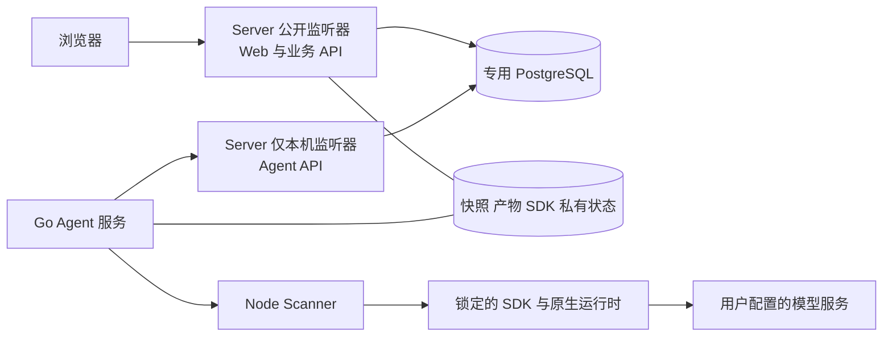

# Axiom Linux 和 Windows 原生安装包改造方案

日期：2026-11-05。状态：阶段 0 已执行依赖冻结和原生诊断；Linux 有条件通过，Windows 仍有源码沙箱读取阻断。详见[阶段 0 验证记录](acceptance/native-stage0-20261105.md)。阶段 1—6 尚未实施。

Axiom 可以复用现有 Go Server、Go Agent、Node Scanner 和 Web 界面，增加原生运行适配与安装维护层，交付 Linux 和 Windows 安装包。用户安装后通过浏览器完成配置、扫描、复核和报告查看；安装器负责依赖、数据库和后台服务。

实施顺序为：双平台运行探针 → 共用安装维护基础 → Linux 原生链路 → Windows 原生链路 → 升级恢复 → 安装器 → 发行验收。Windows SDK、沙箱和进程生命周期的验证应在安装向导制作前开始。

## 交付目标

| 项目 | Linux | Windows |
| --- | --- | --- |
| 正式安装入口 | `Axiom-<version>-linux-<arch>.run` | `Axiom-Setup-<version>-windows-<arch>.exe` |
| 安装器建议 | 固定版本的 Makeself 包装安装负载 | 固定版本的 Inno Setup 包装安装负载 |
| 应用服务 | systemd 管理 Server 和 Agent | Windows SCM 管理 Server 和 Agent |
| 数据库 | 安装器管理专用 PostgreSQL 实例 | 安装器管理专用 PostgreSQL 服务 |
| 用户入口 | 浏览器访问安装时配置的地址 | 安装完成页与快捷方式打开浏览器 |
| 维护入口 | `axiomctl` | `axiomctl.exe`，安装器调用相同维护逻辑 |

建议首轮验收使用 Ubuntu 24.04 x64、Windows 11 x64 和 Windows Server 2022 x64。这个选择来自现有 Linux x64 基线和已声明的 Windows x64 二进制依赖；最终支持矩阵按实际验收结果填写，其他 Linux 发行版、系统版本和 CPU 架构逐项扩展。

用户侧不需要安装 Go、npm 或编译源码，也不依赖 Docker 或 WSL。安装包包含锁定的运行依赖；操作系统基础库、内核能力与可用磁盘空间由安装前检查确认。离线安装所需负载随包提供，扫描时仍需连接用户配置的模型服务。

产品继续采用单机、可信用户的部署模型。保留现有 PostgreSQL、执行合同、历史读取器、原生 V2 和明确选择的兼容运行时。原生包不新增扫描或复核时限、源码范围数量、读取量、模型输出或并发上限；SDK 原生约束和用户显式设置继续生效。

## 已确认的代码缺口

| 位置 | 当前情况 | 改造要求 |
| --- | --- | --- |
| [Server 入口](../code-audit-server/cmd/server/main.go)与 [Agent 入口](../code-audit-agent/cmd/agent/main.go) | 通过环境变量配置，按控制台进程和 Unix 信号启动停止 | 提取可接收 context 的运行函数，增加配置文件加载和 Windows 服务宿主适配 |
| [HTTP 路由](../code-audit-server/internal/httpserver/server.go)与 [Nginx 配置](../deploy/docker/nginx.conf) | Server 注册业务及内部接口，Nginx 提供静态 Web 并屏蔽 `/api/internal/` | 增加原生静态 Web；分离公开路由和仅本机的 Agent 路由，保留原访问边界 |
| [Agent 配置](../code-audit-agent/internal/config/config.go) | Scanner、Node、DataDir 仍有相对目录和系统 PATH 默认值 | 原生安装生成绝对路径、稳定 Agent ID 和明确的运行目录 |
| [Windows 进程管理](../code-audit-agent/internal/scanner/process_windows.go) | 进程组配置和清理函数为空 | 实现每次执行的进程树管理，覆盖正常退出、取消、崩溃和服务停止 |
| [Scanner 父进程监督](../code-audit-scanner/src/runtime/agent-lifecycle.ts) | 当前协议面向 Unix 进程组 | 增加 Windows 等价机制，避免 Agent 退出后 SDK 子进程继续执行 |
| [Deep 续扫](../code-audit-scanner/src/runtime/deep-resume.ts) | 活跃进程检测只读取 Linux `/proc`，非 Linux 分支直接返回 false | Windows 必须提供等价的执行归属与互斥检查，无法确认时拒绝接续 |
| [SDK 校验清单](../deploy/sdk/manifest.json)和 [Scanner 依赖](../code-audit-scanner/package.json) | 声明 Windows x64 可选二进制，但平台校验清单仅包含 Linux x64 二进制基线 | 补 Windows 完整文件哈希、平台负载与运行验收证据 |
| [PDF 导出](../code-audit-server/internal/render/pdf.go) | 从系统路径寻找浏览器，Windows 候选中还包含固定 Administrator 用户目录 | 原生包明确配置浏览器、字体和私有临时目录，并验证服务账户下的导出和清理 |
| [维护工具](../deploy/ops/stack.py) | 初始化、备份、恢复和运行身份记录绑定 Docker Compose | 增加原生维护后端，保留原有 Compose 后端与备份格式读取能力 |
| [数据库模型](../code-audit-server/internal/store/store.go) | 快照、任务和执行记录包含文件系统路径 | 迁移与跨平台读取需要受控路径映射，不能直接复制数据目录后启动 |
| [发布校验](../deploy/release/check.py)与 [发布元数据](../deploy/release/release.json) | 当前平台和部署模式限定于 Linux amd64 与既有单机发行方式 | 按发行目标扩展检查器和验收矩阵，分别记录容器与原生包证据 |

Windows 可编译、依赖声明包含 Windows 包，都不足以证明真实扫描链路可交付。

## 原生运行架构



两个监听器属于同一个 Server 进程，复用业务逻辑与数据库。公开监听器提供 Web、用户 API 和公开健康检查；内部监听器绑定 loopback，并继续校验 Agent token。原有容器模式保持与 Nginx 的兼容路由组合。

Web 建议默认绑定 `127.0.0.1:8088`，安装时允许修改。Agent 内部端口和 PostgreSQL 端口也写入安装配置，检查占用后固定使用。局域网访问由用户在安装配置中明确启用，并配置对应 HTTPS 入口。数据库与 Agent 控制接口保持本机访问。

### 安装目录

| 内容 | Linux 新安装默认值 | Windows 新安装默认值 |
| --- | --- | --- |
| 程序与版本负载 | `/opt/axiom/releases/<version>` | `%ProgramFiles%\Axiom\releases\<version>` |
| 私有配置 | `/etc/axiom` | `%ProgramData%\Axiom\config` |
| 业务数据和 SDK 状态 | `/var/lib/axiom/data` | `%ProgramData%\Axiom\data` |
| PostgreSQL 数据 | `/var/lib/axiom/postgres` | `%ProgramData%\Axiom\postgres` |
| 日志 | `/var/log/axiom` | `%ProgramData%\Axiom\logs` |
| 运行临时文件 | 服务账户专用运行目录 | `%ProgramData%\Axiom\tmp` 下的专用目录 |

安装器支持自定义根目录。程序目录由管理员维护，服务账户仅获得必要的读取和数据写入权限。配置分为 Server 私有配置、Agent 私有配置与非敏感安装元数据，Agent 不读取数据库密码或 Server master key。Windows 使用 ACL 实现访问权限，不能把 POSIX `0600` 当作等价保护。

阶段 0 实测补充：SDK 0.5.0 会校验 Windows 私有状态目录的完整祖先 ACL，当前 runner 的 ProgramData 被拒绝；表中的 Windows SDK 状态位置不能直接作为已验证默认值。需要将 SDK 私有状态与普通业务数据分开选址，检查可信祖先，并为 SDK 沙箱身份授予本次快照的只读权限；详见阶段 0 记录。

当前 VPS 的 `/opt/axiom` 已承载 Compose 安装。迁移时使用独立根目录、服务名前缀、数据目录和端口；安装器发现已有安装时先识别部署类型，拒绝覆盖其他安装。

### 运行负载

每个平台的发布负载包含 Go Server、Go Agent、维护工具、构建后的 Web、Scanner 的编译输出与生产依赖、SDK 插件及校验文件、Node、Python、Git、PostgreSQL 工具、报告浏览器与字体，以及这些组件所需的可分发依赖。

Node 和 SDK 首轮沿用已验证的版本组合。Python、Git、数据库、浏览器及系统库的精确版本在阶段 0 锁定，分别记录来源、完整性校验和平台需求。Windows 可采用 Python 嵌入式发行包，并预装所需 Python 模块；安装后不依赖用户运行 pip。[Python 官方说明](https://docs.python.org/3.13/using/windows.html#the-embeddable-package)

打包时保留 Scanner 对 `deploy/sdk`、contracts、SDK 插件和运行基线文件的相对导入关系。`file:` 工作区依赖和 npm 链接在发布负载中实体化，校验后再封包；运行时不能依赖源码仓库、开发目录或用户的 npm 缓存。

## 需要修改的模块

下列新增路径是建议的实现组织，尚未创建。现有 Go 模块分开管理，公共代码新增为独立 shared 模块，并同步修改相应 `go.mod`；不要跨模块导入受 Go `internal` 规则限制的包。

| 模块 | 现有改动位置 | 拟新增位置与具体职责 |
| --- | --- | --- |
| 原生管理工具 | 复用 `deploy/ops/stack.py` 的初始化和恢复规则 | `code-audit-manager/`：提供安装前检查、初始化、服务维护、备份、恢复、升级和卸载；不新增用户扫描 CLI |
| 配置与目录解析 | 两个 `cmd/*/main.go`、两个 `internal/config/` | `shared/runtimeconfig/`：加载版本化配置文件，解析绝对路径，兼容现有 `AXIOM_*` 配置；继续执行生产密钥与 PostgreSQL 校验 |
| 服务生命周期 | Server 和 Agent 启动入口、`deploy/systemd/` | `shared/servicehost/`、`deploy/native/linux/`、`deploy/native/windows/`：Linux unit 和 Windows SCM 适配，正确上报启动、停止和失败状态 |
| Web 与路由 | `internal/httpserver/server.go`、Server main | `internal/webui/`：发布负载中的只读静态文件托管、SPA 回退、缓存规则和安全响应头；公开与内部路由分别组装 |
| 执行进程树 | `internal/scanner/process_windows.go`、`scanner.go`、身份操作进程启动代码 | 每个执行拥有独立 Windows Job Object；SDK 子进程、并行子任务和身份操作具有正确的生命周期归属 |
| Scanner 平台适配 | `src/runtime/agent-lifecycle.ts`、`deep-resume.ts`、SDK 启动和临时目录配置 | 增加 Windows 的归属检测和能力探针；使用安装负载内的 Python、Node、Git 和服务账户状态目录 |
| SDK 平台校验 | `deploy/sdk/apply.mjs`、`manifest.json`、运行与恢复检查脚本 | 分平台清单和探针，覆盖原生二进制、DLL、插件原生模块、shell、工具调用与沙箱行为 |
| 数据库管理 | 保留 Server 内部迁移和原数据库模型 | 原生 `initdb`、`pg_ctl`、`pg_isready`、`pg_dump`、`pg_restore` 适配；使用专用实例、账户、端口和数据目录 |
| 路径与历史读取 | `internal/snapshot/`、store 路径字段、结果与产物读取、Agent 输入解析、`shared/sourceidentity/` | 增加统一的数据根解析与历史路径映射；覆盖 Windows 文件名、大小写冲突、长路径和 reparse point |
| PDF | `internal/render/pdf.go` 与平台进程清理代码 | 明确浏览器路径、中文字体、Windows file URL 处理、服务账户临时目录和导出进程树清理 |
| 升级与备份 | `deploy/ops/stack.py`、`deploy/release/` | 将一致性保护与平台操作分开；原生发布记录二进制及负载哈希，容器发布继续记录镜像身份 |
| 安装器与发行 | 发布脚本、元数据、源码导出选择、CI 工作流 | `deploy/native/`、原生验收脚本、原生 CI；生成 `.run`、`.exe`、校验清单、第三方组件清单、签名与公开验收摘要 |

### Web 托管细节

Go Server 读取同一发布负载里的 Web 构建产物，首版采用只读 `web/` 目录，随发布清单校验。`index.html` 不长期缓存，带内容哈希的静态资源使用 immutable 缓存；升级后继续提供仍需兼容的旧资源，复用现有静态资源兼容规则。

`/api/`、`/healthz`、`/readyz` 和 Agent 接口不得落入 SPA 回退。缺失资源、未知 API、`/src`、`/node_modules` 与开发服务器入口返回明确错误。保留流式上传下载、SSE、认证与授权语义，不引入覆盖长任务的全局 HTTP 请求时限。

### Windows 服务与执行细节

Server 和 Agent 通过 Windows 服务控制协议接收停止与系统关机通知，将其转为内部 context 取消并上报服务状态。仅依赖 `os.Interrupt` 或 Unix SIGTERM 不足以完成服务适配。[Microsoft 服务控制说明](https://learn.microsoft.com/en-us/windows/win32/services/service-control-handler-function)

每个 Scanner 执行建立独立 Job Object，处理创建进程与加入 Job 之间的竞态，验证与 SDK 嵌套 Job 的兼容性。Agent 异常退出时，其持有的 Job 句柄关闭并终止对应后代；取消一个任务只停止该任务的进程树。身份操作和 PDF 导出也需要各自的归属与清理机制。Job Object 在这里用于生命周期管理，不附加 CPU、内存、时长或进程数量限制。[Microsoft Job Objects 说明](https://learn.microsoft.com/en-us/windows/win32/procthread/job-objects)

服务使用明确的低权限账户、HOME、CODEX_HOME、临时目录和 SDK 私有状态目录。验证用户注销后服务仍工作，服务不依赖交互式用户的 PATH、浏览器配置或登录会话。Windows Job Object 不代替 SDK 的文件访问与网络沙箱，后者单独验收。

`deep-resume.ts` 的 Windows 实现不能沿用“非 Linux 即没有活跃进程”的判断。采用可验证的执行归属、进程创建身份和互斥机制，在检查与启动之间保持同一保护；无法确定归属时返回不能接续的具体原因。继续遵守现有 SDK 恢复基线、原 session、Agent、身份、源码、配置和目录绑定。

旧的 `deploy/patch-codex-runtime.mjs` 不能直接加入新安装流程。先用锁定版本复现 Windows 启动行为；确需兼容修改时，记录行为变化、原因及完整 before/after 哈希，并继续区分官方运行时与兼容运行时，不修改已验证能力的含义。

### 数据库与文件兼容细节

保留 PostgreSQL，首轮沿用 16 主版本，锁定经过验证的维护版本。应用升级与数据库主版本升级分别处理。Windows 使用随包的 PostgreSQL 二进制与 `pg_ctl register` 注册专用服务；PostgreSQL 官方提供用于集成到其他安装器的二进制包。[PostgreSQL 二进制分发](https://www.postgresql.org/download/windows/)、[PostgreSQL 16 服务管理](https://www.postgresql.org/docs/16/app-pg-ctl.html)

Server 和 Agent 使用相同的业务数据根。新写入的数据尽可能采用数据根下的可验证相对定位，同时兼容既有合同与历史记录；确需合同变化时同步生成跨语言合同和兼容样例。归档的报告、原始 JSON、证据和源码不做全局路径字符串替换。

Windows 测试覆盖空格、中文、盘符、分隔符、大小写、长路径、保留文件名、同名大小写冲突和目录链接。无法无损保存的源码快照在导入时明确拒绝，不能静默覆盖、改名、丢文件或改变换行符。Go 与 TS 的源码哈希和路径身份继续一致。

## 分阶段实施

### 阶段 0 冻结依赖与验证双平台运行条件

**工作内容**：选择不可变源码快照，记录源码哈希、发布标识、SDK、Node、合同矩阵和数据库迁移基线。锁定双平台依赖负载及来源，增加 Windows 平台文件校验清单。构建最小原生运行探针，检查 SDK 加载、二进制启动、Python 插件、shell、临时目录、原生模块和沙箱。

探针使用原版 SDK 和隔离的本地模型接口 Fixture，可执行源码读取和工具调用，不需要真实模型密钥。Windows 同时验证服务账户环境、空格及中文目录；Linux 检查内核能力和原生沙箱，不复制容器专用安全配置作为宿主机配置。

**交付物**：平台与依赖矩阵、分平台运行探针、精确负载清单、待解决的运行差异。

**完成条件**：两平台均能使用发布负载中的依赖启动原生 SDK，工具调用和边界检查有可复查结果。任何缺失能力都有具体原因；不能通过关闭校验或提升为管理员运行扫描来取得通过结果。

### 阶段 1 建立共用配置和安装维护基础

**工作内容**：新增 `axiomctl` 和公共配置模块；将 Server、Agent 的运行入口与服务宿主分开。生成稳定安装 ID、Agent ID、密钥、初始管理员配置和目录结构，重复初始化不能重置已有账户或密钥。增加专用 PostgreSQL 初始化与健康检查。

增加公开与内部路由组装及静态 Web 托管。构建 Linux tar 和 Windows ZIP 候选负载，先验证负载能脱离开发仓库运行。配置明确指向随包依赖，不使用用户全局 npm、Git 或 Python 配置。

**交付物**：共用维护命令、版本化配置格式、可独立运行的原生候选负载、原生 Web 入口。

**完成条件**：干净测试环境内完成初始化、启动、登录、历史结果读取和 PDF 导出；公开监听器不能访问 Agent 内部 API；已有容器 Web 与 API 回归通过。

### 阶段 2 完成 Linux 原生服务链路

**工作内容**：更新 systemd unit，配置专用账户、绝对路径、工作目录、环境、日志和依赖就绪顺序；保留 SDK 所需原生沙箱能力。验证 Agent 进程组和 systemd 控制组在正常退出、取消、服务停止和异常退出时的行为。

使用原生候选负载完成上传、Git 差异、标准与 Deep 扫描、组件计划及审计、独立复核、SDK 身份操作、证据图谱和报告下载的隔离链路。能力显示以实际测试为准。

**交付物**：Linux 原生候选版本、服务定义、安装诊断和原生链路验收记录。

**完成条件**：目标 Linux 系统安装后可开机启动；任务、取消、异常恢复、费用与证据归档保持现有语义，旧数据和对应下载内容保持可核验。

### 阶段 3 完成 Windows 原生服务与运行适配

**工作内容**：实现 SCM 宿主和每次执行的 Job Object，补齐 Scanner 父进程监督、SDK 身份操作、PDF 子进程和临时目录清理。完成 Windows 续扫归属检查、配置 ACL、运行账户、路径处理和生产依赖打包。

在真实 Windows 客户端与 Server 虚拟机上，按阶段 2 的业务集合验收，并增加 Agent 强制结束、并行任务局部取消、用户注销、系统重启、目录空格与中文、长路径和文件占用场景。Windows 原生模块在 Windows 构建和运行，交叉编译 Go 不能替代这一步。

**交付物**：Windows 原生候选版本、服务定义、平台适配代码、进程清理与完整链路记录。

**完成条件**：服务正常启动停止，单个任务取消不影响其他任务；Agent 退出后其 SDK 后代不继续执行；功能支持状态准确，未验收功能不会被标记为已支持。

### 阶段 4 完成双平台升级备份与迁移

**工作内容**：为 `axiomctl` 增加维护互斥、全部写入入口的维护模式、完整活动工作检查、一致性备份、验证、恢复和升级。活动工作包括扫描、组件任务、复核、SDK 操作、身份操作、续扫核验和清理作业；以执行合同和存储状态为依据维护清单。

应用按版本安装，数据目录保持稳定。升级前核验目标负载和合同，进入维护状态，在没有活动工作时完成数据库、业务文件、SDK 状态和配置的同一静默窗口备份，再切换 Server 与匹配的 Agent/Scanner、Web。升级失败保留现场，按数据库兼容性决定恢复原负载或在独立目录恢复升级前数据。

新增从 Compose 备份导入原生部署的离线流程。先验证 Linux 容器备份到 Linux 原生安装的迁移，再独立验证 Linux 历史数据到 Windows 的读取迁移。运行中的执行和原生 SDK 检查点继续遵循原 session、目录与运行环境绑定，不通过改写状态强行接续。

**交付物**：带版本和负载身份的原生备份格式、旧格式兼容读取、升级事务记录、回滚与 Compose 导入工具。

**完成条件**：备份可在干净环境恢复，账户、master key、模型配置、历史单价费用、源码、证据和下载哈希正确；损坏备份、覆盖已有安装、并发维护和不兼容回滚均被拒绝，现有工作不被升级工具自动取消。

### 阶段 5 制作 Linux 与 Windows 安装器

**工作内容**：Linux 使用 Makeself 生成 `.run`，Windows 使用 Inno Setup 生成 `.exe`；锁定打包器版本，安装器调用已经验收的 `axiomctl`。两个安装器统一执行检查、解包、初始化、权限配置、服务注册、启动验证与最终入口展示。

安装流程提供目录、端口和初始管理员配置，显示当前步骤与错误原因。Windows 支持交互和静默安装、快捷方式和卸载入口；Linux 输出可直接访问的地址和维护命令。重复安装识别为修复或显式升级，不创建第二套不明数据库。

签名、校验清单、第三方组件和再分发材料随发行准备完成。安装失败按事务记录清理本轮创建的对象；不删除已有业务目录或系统中其他 PostgreSQL 实例。默认卸载保留数据和配置，清除业务数据必须是独立的显式选择。

**交付物**：Linux `.run`、Windows `.exe`、静默安装参数、校验清单、签名材料和安装维护文档。

**完成条件**：干净环境从最终安装器完成安装和使用，不需要开发工具；安装、修复、升级、失败恢复、保留数据卸载及重新安装均有可重复结果。

### 阶段 6 建立发行验收与持续发布

**工作内容**：新增 Linux 和 Windows 原生 CI，复用合同与业务测试，增加安装器、服务、权限、沙箱、升级恢复和历史兼容验收。扩展源码导出选择与发布检查器，按目标记录安装包身份、依赖哈希、合同、支持矩阵和证据。

CI 使用隔离 Fixture 与专用数据，不使用生产数据库、SDK 登录状态或真实模型密钥。真实模型验收在用户已授权的目标、模型配置和预算下单独进行，分别记录操作系统、运行负载、扫描、复核、工具调用、证据和费用范围；不能将 Linux 成功记录当作 Windows 通过证据。

**交付物**：同一源码快照的双平台发行候选、CI 结果、真实链路证据、安装升级文档与可核验的下载材料。

**完成条件**：拟支持平台的必要能力通过；安装和维护路径具备恢复证据，发行说明准确标注能力及限制，方可将相应平台标记为可交付。

## 维护命令设计

以下为拟实现接口，当前不能直接执行：

```text
axiomctl doctor
axiomctl init
axiomctl service install
axiomctl start
axiomctl stop
axiomctl status
axiomctl logs
axiomctl backup <destination>
axiomctl verify <backup>
axiomctl restore <backup> --target <new-installation>
axiomctl upgrade <verified-release-package>
axiomctl uninstall
```

命令可输出供安装器和 CI 使用的结构化结果。状态包含各服务、数据库、SDK 及依赖版本、合同兼容状态、安装位置与下一步操作；诊断导出按字段脱敏，不输出模型密钥、数据库密码、master key 或 SDK 会话凭据。任务创建、扫描配置、复核与证据查看继续在 Web 完成。

普通服务重启可以按系统服务策略自动进行，但不得因此默认重跑扫描或改变未知费用处理。维护模式检查到活动工作时说明具体对象，由用户完成或取消后再升级，不自动给执行施加新的截止时间。

## 升级和备份约束

1. **保留原密钥与身份**：重装、升级不重新生成已有 master key、Agent ID、SDK 身份与数据库凭据；恢复保留业务身份并撤销旧浏览器会话。
2. **保证一致性**：备份不仅是 `pg_dump`；模型凭据、业务产物、SDK 状态和配置必须对应同一停止写入窗口，恢复前验证完整清单和哈希。备份中的密钥材料以可离机恢复的加密方案保护，恢复材料由用户保管。
3. **区分应用与数据库升级**：应用版本切换不自动更换 PostgreSQL 主版本；已有迁移的编号与字节保持，新增迁移单独评估。
4. **按兼容性回滚**：新版本尚未迁移数据库时可恢复旧程序；迁移后按认证的兼容矩阵操作，不能只换回 exe。需要恢复数据时先保留失败现场，在独立目标恢复旧备份并说明恢复点。
5. **维护操作可恢复**：安装、修复、升级和卸载使用互斥及持久步骤记录，断电或退出后能识别上次结果；操作只作用于本安装拥有的对象。
6. **保留私有状态**：SDK 状态、冻结价格、费用核对、未完成清理意图和历史产物继续按现有规则保存；迁移不批量重写原始报告或伪造逐节点源码定位。

## 当前 VPS 数据迁移步骤

当前 VPS 继续保留 Compose 服务与数据卷。原生部署成熟后，再执行以下独立迁移：

1. 从当前部署取得经过验证的一致性加密备份、配置与发布身份，保留原环境和镜像。
2. 在独立根目录、数据库、服务名称和端口安装原生候选版本，防止与现有 `/opt/axiom`、端口和数据卷冲突。
3. 离线导入数据库和业务文件，建立旧数据根到新数据根的受控路径映射；对只能在原环境解释的 SDK 状态明确保留绑定。
4. 核对历史业务表、模型与密钥、价格费用、源码内容、发现与复核、报告及产物下载；验证原生实例中的新任务不写回原数据库或文件卷。
5. 切换访问入口前明确停写点，并将最后一批增量变化纳入新的最终一致性备份与恢复核对，不能将旧备份直接作为有持续写入的环境的切换依据。
6. 完成切换后保留原部署作为恢复现场。启用原生实例新写入后的回退需要评估新数据，不能直接启动旧环境并丢弃期间任务与费用记录。

本方案阶段只设计流程；实际迁移使用届时的真实数据基线，另行执行验收。

## 验收矩阵

| 验收领域 | 两个平台都需要证明的结果 |
| --- | --- |
| 干净安装 | 直接使用最终安装器，无开发工具和用户全局依赖；目录、服务、账户和端口正确 |
| 安装失败 | 权限不足、端口冲突、依赖缺失、空间不足和损坏负载给出具体原因；修复不覆盖历史数据 |
| 入口和权限 | Web 正常访问与刷新，内部接口不出现在公开监听器；私有配置和 SDK 状态只有指定账户可读 |
| 核心业务 | 标准、Deep、差异、组件任务、独立复核及身份操作分别验收，完整展示执行状态、原始结果、证据和费用语义 |
| 长任务和并发 | 用户设置与 SDK 原生并发保持；局部取消、服务停止和异常退出不遗留 SDK 后代，也不影响其他执行 |
| 沙箱 | 预期源码和任务临时目录可访问，未授权位置的访问按原有边界阻断；服务账户与 SDK 沙箱分别核验 |
| 文件与 PDF | 中文和空格目录、长路径、源码哈希、产物下载、服务账户 PDF、取消导出后的进程及临时文件清理正确 |
| 数据保护 | 升级前后历史行、价格费用、模型配置、源码、证据及下载哈希正确；无效备份和覆盖恢复被拒绝 |
| 重启与续扫 | 重启恢复已有产品状态，不默认为用户重跑任务；SDK 续扫仅在原有资格检查全部成立时可用 |
| 卸载与重装 | 默认保留数据库、产物、配置及解密材料；重装不改变已有账户密码、Agent 身份和业务记录 |
| 发布真实性 | 平台、版本、负载、合同、支持能力与测试证据对应；Fixture、真实模型测试和未验收能力清楚区分 |

## 工作包顺序和后续扩展

建议按以下可独立评审的工作包推进：

1. 双平台依赖与 SDK 运行探针。
2. 共用配置、维护 CLI、服务宿主，以及公开和内部路由拆分。
3. Linux 原生负载和服务验收。
4. Windows 进程管理、服务及路径适配和原生验收。
5. 一致性备份、升级回滚与现有 Compose 数据导入。
6. 两种安装器、签名和发行 CI。

首轮重点交付完整的安装、使用、升级与恢复体验。原生客户端外壳、系统托盘、自动后台升级、商业授权服务、更多 Linux 包格式和远程执行节点可在这条链路稳定后分别扩展。系统设置中的版本、安装状态和诊断入口复用既有领域组件；涉及 UI 实施时遵循仓库的设计哲学、组件和 Token 规范。

打包工具的能力依据：[Makeself 官方仓库](https://github.com/megastep/makeself)、[Inno Setup 官方说明](https://jrsoftware.org/isinfo.php)。在锁定打包器和随附组件时记录适用的再分发材料与使用条件，沿用仓库的 LICENSE、NOTICE 和第三方来源记录。
